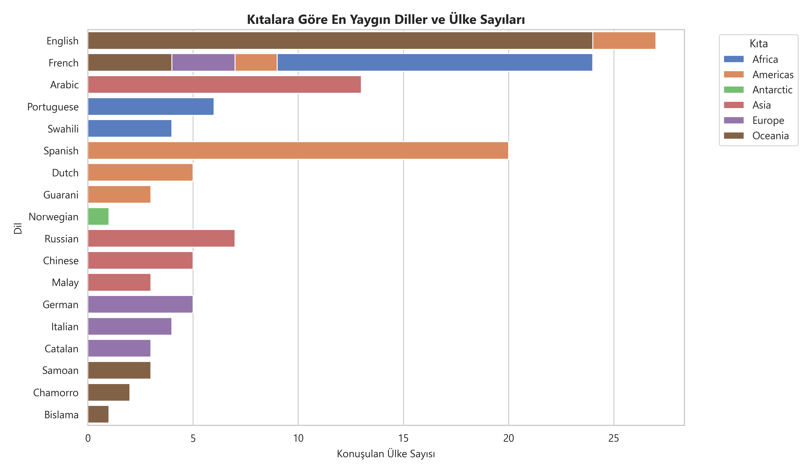
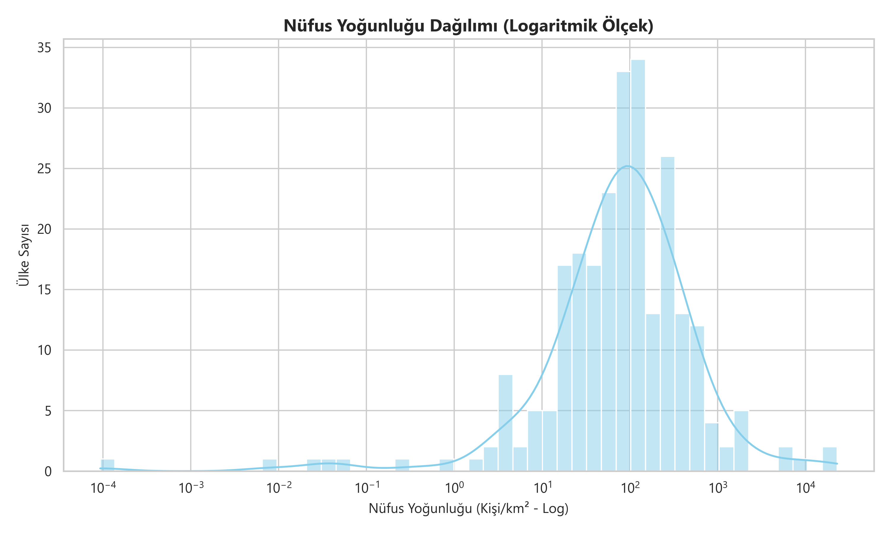
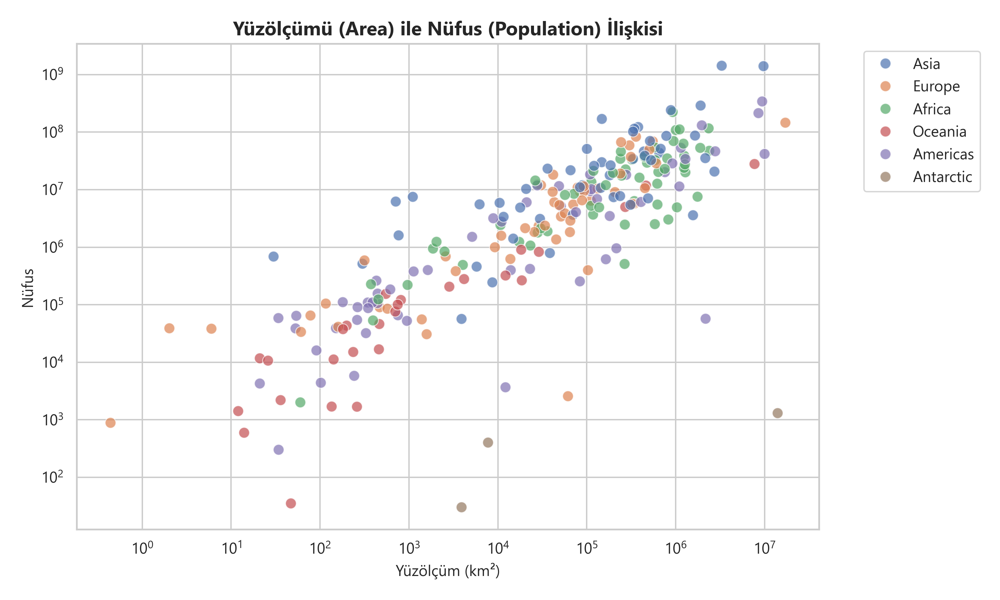

# API'den Veriye: Kendi Dataset'ini Oluşturma (REST Countries EDA)

Bu proje, **REST Countries v5 API** üzerinden dünya ülkelerine ait sosyo-coğrafi verileri toplayan, temizleyen, keşifsel veri analizi (EDA) uygulayan ve istatistiksel sonuçları görselleştiren uçtan uca bir veri bilimi çalışmasıdır.

---

## 1. Problem

- **Seçilen API:** [REST Countries API (v5)](https://restcountries.com)
- **Seçilme Nedeni:** Dünya genelindeki 254 ülkeye ait demografik, coğrafi ve sosyo-kültürel (nüfus, alan, resmi diller, bölgeler) verileri zengin bir hiyerarşide sunması ve çok boyutlu keşifsel veri analizine imkân tanımasıdır.
- **Araştırma Soruları:**
  1. *Kıtasal Dil Dağılımı:* Hangi kıtada hangi diller en yaygın olarak konuşuluyor ve kaçar ülkede resmi/yaygın dil statüsündedir?
  2. *Nüfus Yoğunluğu (Population Density):* Ülkelerin nüfus ve yüzölçümü ilişkisine göre nüfus yoğunlukları (kişi/km²) küresel ölçekte nasıl dağılmaktadır? En yoğun ve en seyrek ülkeler hangileridir?
  3. *Alan-Nüfus İlişkisi (Korelasyon):* Bir ülkenin yüzölçümünün büyüklüğü ile nüfusu arasında doğrusal ve istatistiksel olarak anlamlı bir ilişki (korelasyon) var mıdır?

---

## 2. Veri

- **Veri Kaynağı:** `https://api.restcountries.com/countries/v5`
- **Verinin Çekildiği Tarih:** Kasım 2026
- **Kayıt ve Sütun Sayısı:** 
  - Ham veri: 254 ülke kaydı (JSON formatında, iç içe nesneler ve diziler)
  - Temizlenmiş veri: 254 satır, 7 temel analiz sütunu (`Country`, `Official_Name`, `Population`, `Area`, `Alpha2_Code`, `Region`, `Languages`) + türetilen `population_density` metriği.
- **Kullanılan Alanlar:**
  - `names.common` & `names.official`: Ülke yaygın ve resmi isimleri
  - `population`: Ülke nüfusu (sayısal)
  - `area.kilometers`: Ülke yüzölçümü (km²)
  - `region`: Ülkenin yer aldığı kıta / coğrafi bölge
  - `languages`: Konuşulan diller listesi
  - `codes.alpha_2`: İki haneli ISO ülke kodu

---

## 3. Yöntem

1. **Veri Toplama (Data Ingestion):**
   - REST Countries v5 API'sinin sayfalamalı (pagination - limit & offset) mekanizması kullanılarak tüm ülkeler çekilmiştir.
   - API anahtarı güvenliği için `.env` ve `python-dotenv` kullanılmış, anahtar kod içine yazılmamış ve `.gitignore` ile korunmuştur.
   - Çevrimdışı çalışma veya API kesintilerine karşı yerel yedekleme (`data/raw/countries.json`) ve çift kademeli fallback mekanizması kurulmuştur.
2. **Veri Ön İşleme ve Temizleme (Data Cleaning):**
   - İç içe (nested) JSON hiyerarşisi düzleştirilmiştir (`pd.json_normalize` ve sözlük ayrıştırmaları).
   - Eksik değer analizi (`isna().sum()`) yapılmış; nüfus, alan veya bölge bilgisi eksik olan kayıtlar kontrol edilmiştir.
   - Tekrar eden kayıt denetimi (`duplicated()`) gerçekleştirilmiştir.
   - Veri tipleri sayısal analize uygun hale getirilmiştir (`pd.to_numeric`).
   - `population_density = population / area` formülüyle kişi başına düşen km² yoğunluğu hesaplanmıştır.
   - Temizlenmiş veri `data/processed/countries_processed.csv` olarak dışa aktarılmıştır.

---

## 4. Bulgular

### Soru 1: Kıtasal Dil Dağılımı
- **Bulgu:** Küresel sömürgecilik ve ticaret geçmişinin bir sonucu olarak Afrika kıtasında en yaygın diller İngilizce (26 ülke) ve Fransızca (24 ülke); Amerika kıtasında İngilizce (27 ülke) ve İspanyolca (20 ülke); Okyanusya'da ise İngilizce (24 ülke) ve Fransızca (4 ülke) olarak öne çıkmaktadır.



### Soru 2: Nüfus Yoğunluğu Dağılımı
- **Bulgu:** Dünya genelinde nüfus son derece dengesiz dağılmaktadır. Şehir devletleri ve adalar ekstrem yoğunluklara sahiptir: Macau (~22.883 kişi/km²), Monako (~19.236 kişi/km²) ve Singapur (~8.744 kişi/km²) zirvededir. Buna karşılık Grönland (0,026 kişi/km²) ve Antarktika (0,0001 kişi/km²) en seyrek yerleşimlerdir.



### Soru 3: Yüzölçümü ve Nüfus İlişkisi (Korelasyon)
- **Bulgu:** Yüzölçümü ile nüfus arasındaki Pearson korelasyon katsayısı **0.4024** olarak hesaplanmıştır. Bu pozitif ancak zayıf-orta düzeydeki korelasyon, bir ülkenin coğrafi olarak büyük olmasının otomatik olarak kalabalık bir nüfusa sahip olacağı anlamına gelmediğini (örn. geniş çöl veya kutup alanlarına sahip Kanada, Rusya, Avustralya gibi ülkeler nedeniyle) göstermektedir.



---

## 5. Sınırlılıklar

- **Kalıcı Nüfusu Olmayan Bölgeler:** Antarktika ve Bouvet Adası gibi araştırma üssü statüsündeki bölgelerde kayıtlı daimi nüfus 0 veya sembolik değerlerdedir; bu durum histogram ve korelasyonda uç değer (outlier) oluşturabilmektedir.
- **Yüzölçümü-Yaşam Alanı Ayrımı:** Analizdeki alan metriği ülkenin toplam idari yüzölçümüdür; yaşanabilir (arable / habitable) alan ayrımı içermediğinden çöl veya dağlık alanlara sahip ülkelerde yoğunluk fiili durumu tam yansıtmayabilir.
- **Çok Dilli Yapılar:** Bazı ülkelerde birden fazla resmi veya yaygın dil tanındığı için dil frekans toplamları toplam ülke sayısını aşabilmektedir.

---

## 6. Proje Yapısı ve Çalıştırma

### Proje Klasör Düzeni
```text
data_project/
│
├── .env                              # API Bearer Token ortam değişkeni (gizli dosya)
├── .env.example                      # Örnek ortam değişkenleri şablonu
├── .gitignore                        # Git hariç tutma kuralları (.env ve raw veriler)
├── requirements.txt                  # Gerekli Python kütüphaneleri listesi
├── README.md                         # Proje dokümantasyonu ve rehberi
│
├── main.py                           # Tüm pipeline'ı tek komutla koşturan orkestratör
├── get_countries.py                  # REST Countries API'den sayfalamalı veri çekme scripti
├── process_data.py                   # Ham veriyi işleme, temizleme ve normalizasyon scripti
├── analyze_correlation.py            # Yüzölçümü ve nüfus korelasyon analiz scripti
├── analyze_density.py                # Nüfus yoğunluğu hesaplama ve analiz scripti
├── analyze_languages.py              # Kıtalara göre dil dağılımı analiz scripti
├── visualize_data.py                 # İstatistiksel grafikleri üreten script
├── generate_report.py                # Markdown nihai rapor derleyici script
│
├── data/
│   ├── raw/
│   │   └── countries.json            # API'den gelen 254 ülkelik ham JSON verisi
│   └── processed/
│       ├── countries_processed.csv           # Temizlenmiş ve analize hazır ana veri seti
│       ├── area_population_correlation.csv   # Yüzölçümü-nüfus korelasyon tablosu
│       ├── population_density_summary.csv    # Nüfus yoğunluğu sıralama tablosu
│       └── continent_languages_summary.csv   # Kıtasal dil frekans tablosu
│
├── notebooks/
│   └── analysis.ipynb                # Adım adım çalıştırılabilir analiz ve EDA notebook'u
│
├── figures/                          # Keşifsel analiz grafikleri (PNG formatında)
│   ├── area_vs_population_scatter.png
│   ├── continent_languages_bar.png
│   └── population_density_hist.png
│
└── reports/
    ├── final_report.md               # Nihai araştırma raporu
    └── figures/                      # Raporda kullanılan görsel grafik kopyaları
        ├── area_vs_population_scatter.png
        ├── continent_languages_bar.png
        └── population_density_hist.png
```

### Kurulum ve Çalıştırma Adımları

1. **Depoyu klonlayın ve bağımlılıkları yükleyin:**
   ```bash
   pip install -r requirements.txt
   ```

2. **Ortam değişkenlerini ayarlayın:**
   `.env.example` dosyasını kopyalayarak `.env` oluşturun:
   ```env
   REST_COUNTRIES_API_TOKEN=your_token_here
   ```

3. **Notebook ile İnceleme:**
   `notebooks/analysis.ipynb` dosyasını VS Code veya Jupyter üzerinde açarak **Restart & Run All** seçeneğiyle tüm adımları görsel olarak çalıştırabilirsiniz.

4. **Terminal / Pipeline Olarak Çalıştırma:**
   Tüm veri toplama, işleme, analiz ve raporlama adımlarını tek komutla koşturmak için:
   ```bash
   python main.py
   ```
