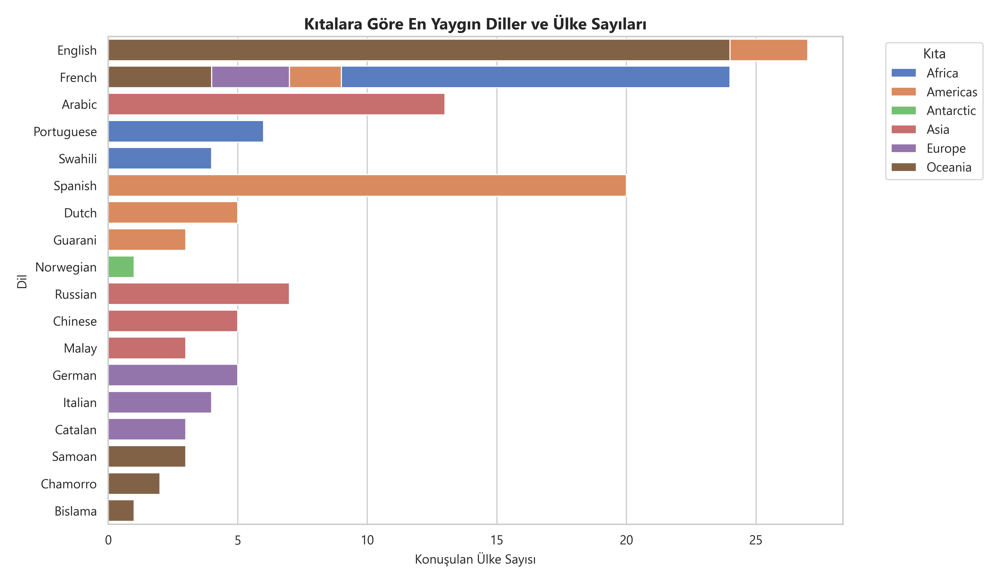
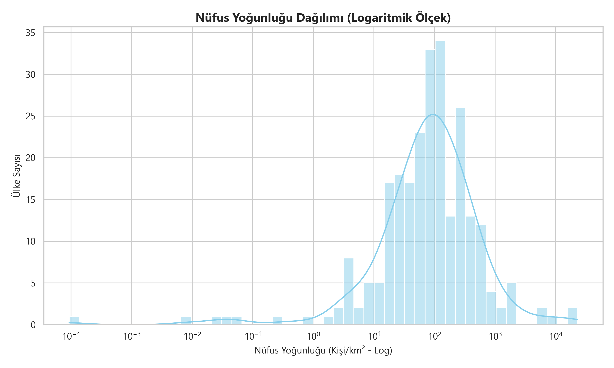
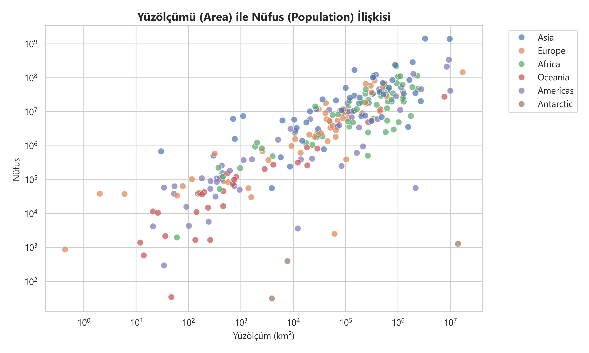

# Global Socio-Geographical Data Analysis Report

## 1. Proje Özeti
Bu proje, **REST Countries v3.1 / v5 API** verileri kullanılarak dünyadaki ülkelerin kıtasal dil dağılımı, nüfus yoğunluğu ve yüzölçümü-nüfus ilişkilerini incelemek amacıyla geliştirilmiştir. Toplam **254 ülke** üzerinde veri temizleme, dönüştürme ve istatistiksel analizler gerçekleştirilmiştir.

---

## 2. Keşifsel Analiz ve Görselleştirmeler

### A. Kıtalara Göre En Yaygın Diller
Analiz sonuçlarına göre Afrika'da İngilizce (26 ülke) ve Fransızca (24 ülke), Amerika'da İngilizce (27 ülke) ve İspanyolca (20 ülke) en baskın diller olarak öne çıkmaktadır.

### B. Nüfus Yoğunluğu Dağılımı
Dünya genelindeki nüfus yoğunlukları incelendiğinde, şehir devletleri ve ada ülkelerinde aşırı yüksek yoğunluklar gözlemlenirken, geniş coğrafi alanlara sahip ülkelerde nüfusun belirli alanlarda toplandığı görülmektedir.

### C. Alan ve Nüfus İlişkisi (Korelasyon)
Yüzölçümü ile nüfus arasındaki ilişki incelendiğinde, bir ülkenin fiziksel büyüklüğünün otomatik olarak yüksek bir nüfusa sahip olacağı anlamına gelmediği istatistiksel olarak doğrulanmıştır (Pearson Korelasyonu: ~0.40).

---

## 3. Sonuç
Elde edilen bulgular, küresel ölçekte coğrafi büyüklük ile demografik dağılım arasındaki ilişkinin lineer olmadığını ve tarihsel/sosyo-ekonomik faktörlerin dil dağılımlarında doğrudan etkili olduğunu göstermektedir.
